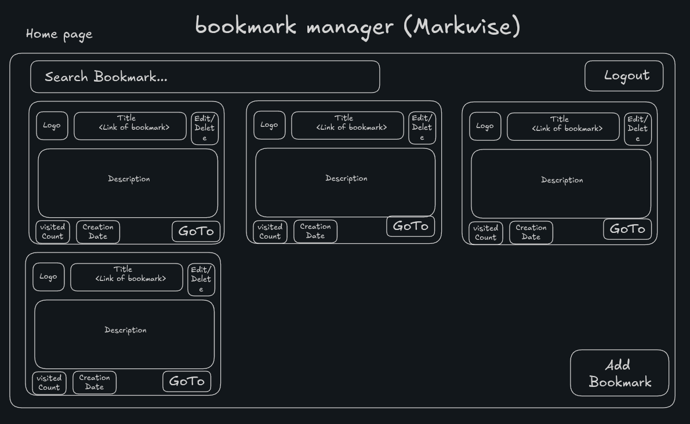

# Markwise
A bookmark manager for managing all your bookmarked pages

## Sample Design



## Database Design

```javascript
const users = [
    {
        id: 1,
        username: "vaibhav",
        password: "123123"
    },
    {
        id: 2,
        username: "cheryl",
        password: "123123"
    }
];

const bookmarks = [
    {
        id: 1,
        title: "Claude",
        logo: "",
        description: "An AI assistant created by Anthropic",
        link: "https://claude.ai/new",
        visitedCount: 10,
        createdAt: "10 Feb 2026",
        userId: 1
    },
    {
        id: 2,
        title: "ChatGpt",
        logo: "",
        description: "An AI assistant created by OpenAI",
        link: "https://chatgpt.com/",
        visitedCount: 4,
        createdAt: "10 Mar 2026",
        userId: 2
    },
    {
        id: 3,
        title: "Dev Community",
        logo: "",
        description: "Social network for software developers",
        link: "https://dev.to/",
        visitedCount: 29,
        createdAt: "3 Jan 2026",
        userId: 1
    }
]
```

## API Endpoints

1. POST `/signup` - Register a user
2. POST `/signin` - Login and return JWT
3. POST `/bookmark` - Create new bookmark
4. GET `/bookmarks` - Get all bookmarks for that user
5. PUT `/bookmark/:id` - Update bookmark with id (Can updated title, description, link)
6. DELETE `/bookmark/:id` - Delete the bookmark having id provided in path params
7. GET `/bookmark/:id` - Get bookmark with given id
8. PUT `/incrementCount/:id` - Increment visitedCount of bookmark with given id
9. POST `/signout` - Logout a user
10. GET `/bookmarks?search={searchValue}` - Returns all bookmarks whose title or description contains searchValue
